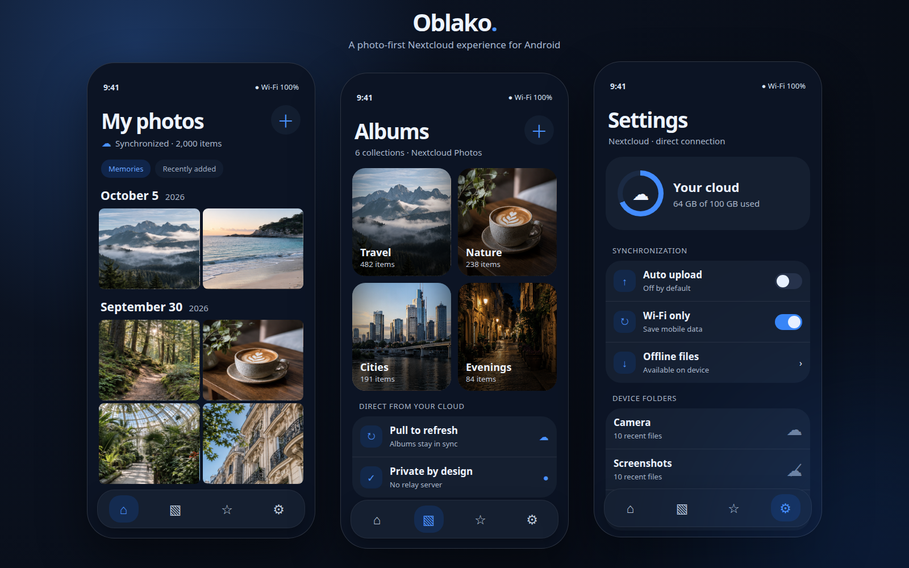

# Oblako — a beautiful, private Nextcloud photo gallery for Android

**Oblako** is an open-source Android photo gallery and media client built for Nextcloud. It brings a modern, fast, Google Photos-inspired experience to a self-hosted cloud without adding a proxy server, a tracking backend, or a second account system.

The project aims to be the most beautiful native Android gallery available for Nextcloud: a calm photo-first interface, fluid motion, direct synchronization, efficient large-library browsing, real albums, favorites, upload controls, transfer status, local folders, deleted files, and a focused full-screen viewer.

> Your phone connects directly to your Nextcloud server. Oblako does not operate an intermediary service and does not receive your credentials, photographs, or account data.

<p align="center">
  
</p>

The interface is the product: edge-to-edge media, compact typography, calm dark surfaces, animated cloud state, fast gestures, and controls that stay out of the photographs. The preview above uses the original visual-design image set bundled with the project mockup; no personal cloud media or account information is included.

## Why Oblako

The official Nextcloud Android client is an excellent general-purpose file manager, but a photo library deserves a dedicated experience. Oblako is designed around photographs rather than folders:

- a responsive chronological photo timeline;
- native Android UI built with Jetpack Compose and Material 3;
- direct Nextcloud Login Flow v2 authentication;
- direct WebDAV and OCS communication with your own server;
- no custom cloud backend and no server-side Oblako component;
- large-library pagination in chunks of 500 media items;
- pull-to-refresh and fast navigation to a specific part of the library;
- Nextcloud Photos albums, album creation, and moving selected media into albums;
- favorites synchronized with Nextcloud;
- multi-select by long press, including continuous drag selection across rows;
- sharing, deletion, download, and transfer progress;
- swipe navigation in the full-screen photo viewer;
- local device folders and explicit, opt-in synchronization controls;
- auto-upload disabled by default until the user enables it;
- light, dark, and system theme modes;
- dedicated sections for Events, Media, Albums, Transfer Status, Synchronization, On Device, and Deleted Files;
- smooth entrance, navigation, cloud-state, and viewer animations;
- an opaque floating bottom navigation bar that automatically hides while scrolling down and returns when scrolling up or pausing.

## Privacy and security model

Oblako deliberately keeps the architecture small and auditable.

1. The user enters the address of their own Nextcloud instance.
2. The app opens the standard Nextcloud Login Flow v2 page in the browser.
3. Nextcloud authenticates the user and issues a dedicated app password.
4. The app stores that app password only in encrypted local storage backed by Android Keystore.
5. All media and metadata requests go directly from the Android device to the selected Nextcloud server.

Nextcloud remains responsible for authentication, authorization, access control, TLS configuration, storage policy, and server security. Oblako does not ask for an administrator account and does not require any Nextcloud plugin, root access, or server modification.

Additional privacy properties:

- no analytics SDK;
- no advertising SDK;
- no telemetry service;
- no hard-coded server, username, token, or personal media;
- Android cloud backup and device-to-device transfer are disabled for app data;
- passwords and authorization headers are excluded from logs and the Room database;
- local database records contain only non-secret metadata, synchronization state, and transfer queues.

See [Privacy and data handling](docs/PRIVACY.md) and [Security policy](SECURITY.md).

## Nextcloud integration

Oblako uses public user-facing Nextcloud protocols and APIs:

- **Login Flow v2** for browser-based authentication;
- **WebDAV** for listing, uploading, downloading, deleting, moving, and reading media;
- **OCS APIs** for account information, activity, quota, favorites, trash, and Photos integration where available;
- **Nextcloud Android Library** as the official client foundation;
- resumable Nextcloud chunking for large uploads;
- ETag-based incremental synchronization and cache validation.

There is no Oblako backend to deploy. If Nextcloud works in a browser and exposes its standard APIs, the Android app can connect to it. HTTPS is strongly recommended. Cleartext HTTP remains available for user-supplied local-network installations.

## Gallery and performance

The media timeline is designed for large personal libraries. Initial content is loaded in a bounded 500-item window instead of materializing the entire remote collection. Reaching the end loads the next window. Fast-scroller jumps request the relevant remote range, allowing the user to reach a distant period without forcing every preceding thumbnail into memory.

Thumbnail work is bounded and cached. Room stores a local metadata index, WorkManager owns durable background work, and remote files remain the source of truth. The test suite includes a 50,000-item media scenario, Room migrations, durable upload queue behavior, authentication, WebDAV parsing, OCS responses, auto-upload policy, and synchronization behavior.

## Upload and synchronization behavior

Synchronization is explicit and conservative:

- all device folders start with synchronization **disabled**;
- auto-upload is disabled by default;
- the user chooses exactly which folders may upload;
- Wi-Fi-only behavior is configurable;
- transfer status shows queued, active, completed, paused, and failed jobs;
- large uploads use resumable chunks when supported by the server;
- name conflicts do not silently overwrite existing remote files;
- pull-to-refresh updates the gallery after a completed upload;
- retryable network failures remain visible and can be retried.

## Technology

- Kotlin
- Jetpack Compose
- Material 3
- AndroidX Room
- AndroidX WorkManager
- Kotlin Coroutines and Flow
- OkHttp
- Kotlin Serialization
- Nextcloud Android Library
- Android Keystore
- Gradle 9 and Android Gradle Plugin 9

## Requirements

- Android 8.0 (API 26) or newer
- a reachable Nextcloud installation
- a regular Nextcloud user account
- JDK 17 and Android SDK 37 to build from source

## Download APK

Download the current Android package from [GitHub Releases](https://github.com/manulAFQ/nextcloud-apk-redisigned/releases/latest). Release assets are built from the corresponding public source revision. Android may ask you to allow installation from the browser or file manager used to open the APK.

## Build from source

Clone the repository and build the debug APK:

```bash
git clone https://github.com/manulAFQ/nextcloud-apk-redisigned.git
cd nextcloud-apk-redisigned
./gradlew assembleDebug
```

The APK is written to `app/build/outputs/apk/debug/app-debug.apk`.

Run the unit tests and Android lint checks:

```bash
./gradlew testDebugUnitTest lintDebug
```

For a release build and signing guidance, see [Release guide](docs/RELEASE.md).

## First connection

1. Install the APK.
2. Enter the base URL of your Nextcloud installation, including a subpath if Nextcloud is installed under one.
3. Tap **Sign in with Nextcloud**.
4. Complete the familiar Nextcloud page in your browser.
5. Return to Oblako; the media timeline and albums will synchronize directly with your account.

Oblako contains no default server. Installing an update over an older local build preserves Android application data; uninstall the old build or clear its storage if you also want to remove the existing on-device session and cache.

## Project documentation

- [Technical specification](docs/TECHNICAL_SPEC.md)
- [Twelve-stage Android backend roadmap](docs/BACKEND_ROADMAP.md)
- [Release and verification guide](docs/RELEASE.md)
- [Privacy and data handling](docs/PRIVACY.md)
- [Contributing](CONTRIBUTING.md)
- [Security policy](SECURITY.md)

## Project status

Oblako is under active development. Core authentication, direct Nextcloud access, photo timeline, albums, favorites, local folders, opt-in upload, synchronization controls, transfer queue, themes, sharing, deletion, and full-screen viewing are implemented. Compatibility may vary across Nextcloud and Photos app versions, reverse proxies, authentication providers, and server configurations. Useful bug reports should include Android version, Nextcloud version, Photos app version, the failed operation, and sanitized logs with all URLs and account identifiers removed.

## Search keywords

Nextcloud Android gallery, Nextcloud Photos app, open-source Google Photos alternative, self-hosted photo backup, private cloud gallery, Android WebDAV photo client, Nextcloud album app, Android photo synchronization, self-hosted media library, private photo manager, open-source Android gallery, Nextcloud auto upload.

## License

Oblako is released under the [MIT License](LICENSE). Third-party libraries remain under their respective licenses. Nextcloud is a trademark of Nextcloud GmbH; this independent project is not affiliated with or endorsed by Nextcloud GmbH.
